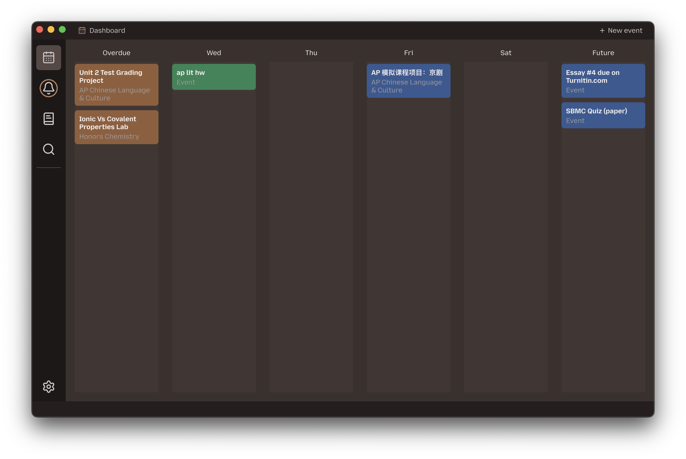
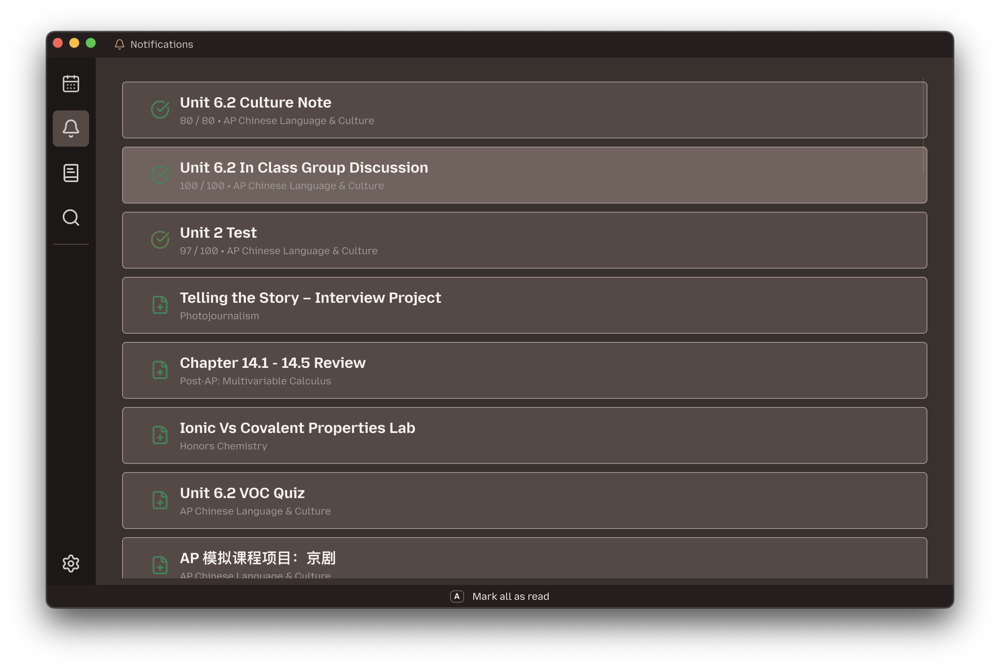
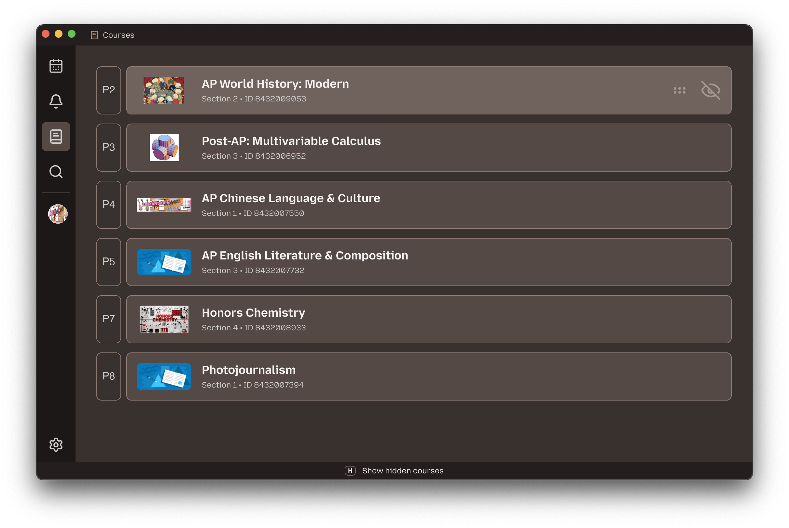
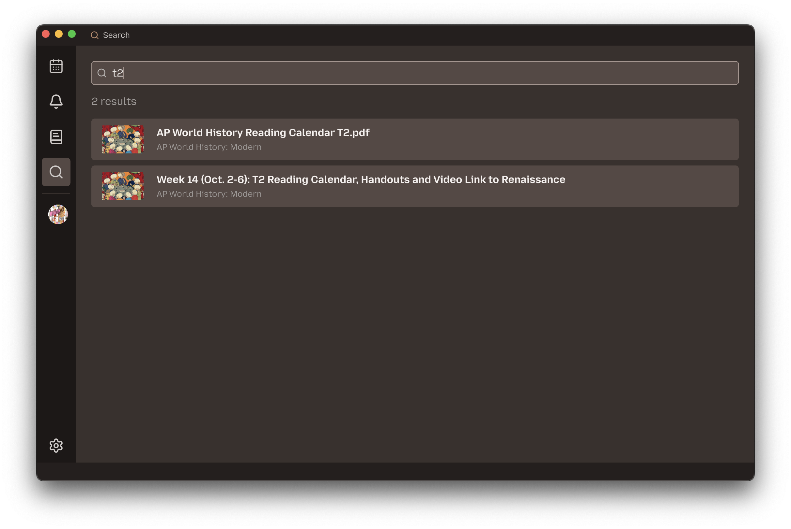
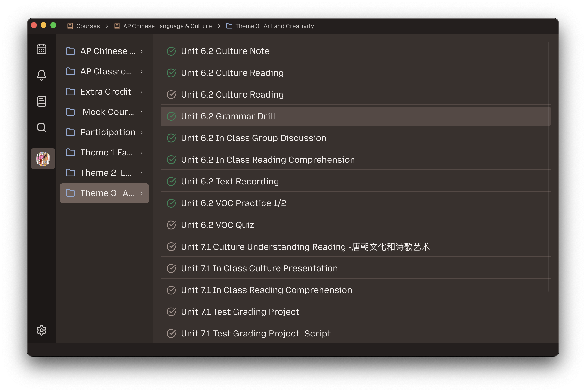
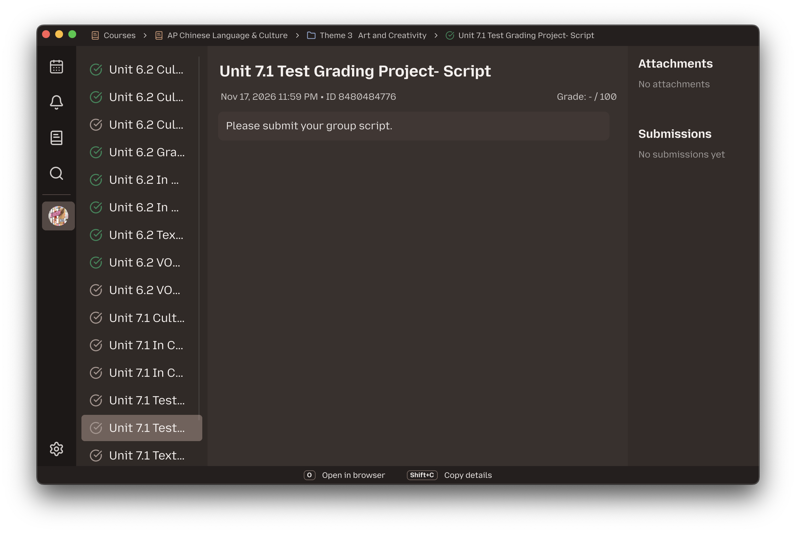
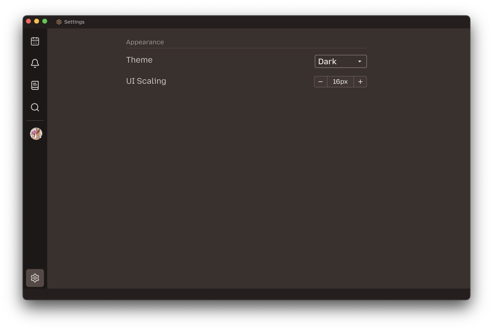

# foam

Alternate client for [Schoology LMS](https://www.powerschool.com/products/classroom/learning-management)

Uses **API key** and **calendar URL** to import assignments, make sure you have access to both



## Installation

To install, download the relevant app binary in the [latest release](https://github.com/orangishcat/foam/releases/latest) based on your platform.

**MacOS only**: After opening the disk image and adding to Applications, you must unquarantine the application. Otherwise you might get an error saying the application is damaged. To do so, run these commands in your terminal once Foam is in your Applications folder:

```bash
cd /Applications
xattr -r -d com.apple.quarantine foam.app
```

## Features

- Intuitive stacking calendar for easy assignment managing
- Mark as done functionality and overdue tracking
- Submissions tracking using Schoology API
- Notifications page reimplementation showing all posted assignments and materials, with mark as read/unread functionality
- Clean, local backup of Schoology contents for offline use and quick searching
- Fast, responsive materials viewing using the local copy of Schoology materials
- Adjustable UI size and themes

## More images

|                                                   |                                              |                                          |
| ------------------------------------------------- | -------------------------------------------- | ---------------------------------------- |
|  |        |      |
|               |  |  |

## Future expansion

No plans as of right now. If anybody has ideas (e.g. other LMS support) and is willing to contribute, I could consider resuming development on this project. But for now it serves my needs.

## Build from source

This is a Rust + [Slint](https://slint.dev) project.

1. Clone source
2. Install `cargo` if you haven't already.
3. `cargo build` or `cargo run` in the project root.
