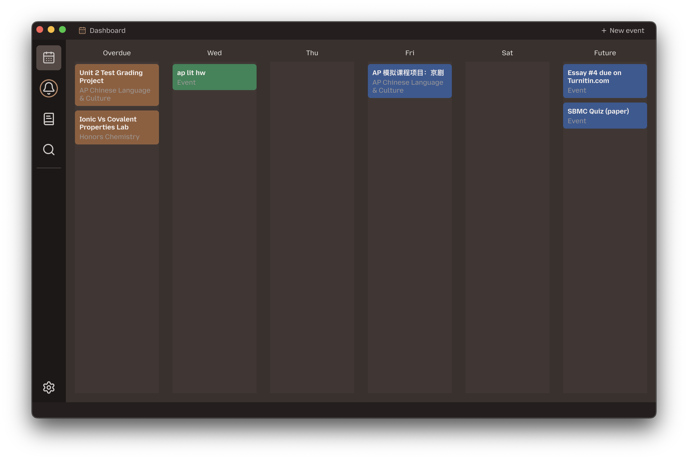
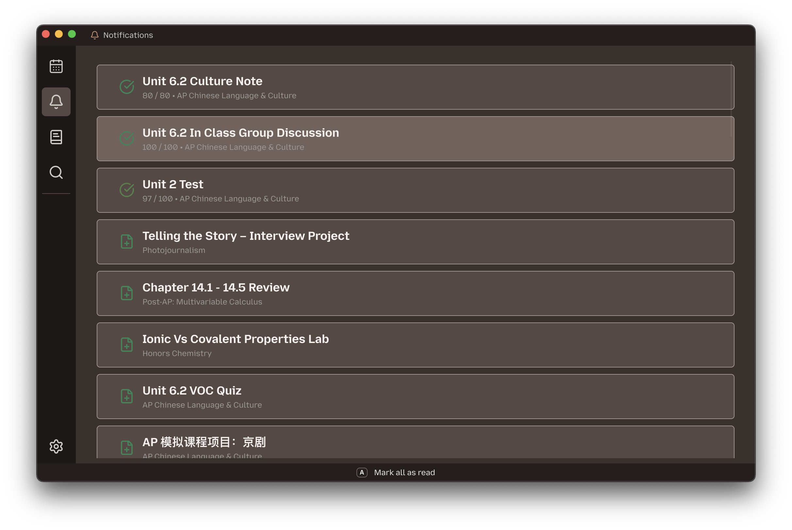

# foam

alternate schoology client

|  |  |
| ----------------------------------- | -------------------------------------------- |

To install, download the relevant app binary in the latest release based on your platform.

## Features

- Intuitive stacking calendar for easy assignment managing
- Mark as done functionality and overdue tracking
- Submissions tracking using Schoology API
- Notifications page reimplementation showing all posted assignments and materials, with mark as read/unread functionality
- Clean, local backup of Schoology contents for offline use and quick searching
- Fast, responsive materials viewing using the local copy of Schoology materials
- Adjustable UI size and themes

## Future expansion

No plans as of right now. If anybody has ideas (e.g. other LMS support) and is willing to contribute, I could consider picking the project back up.

## Build from source

This is a Rust + [Slint](https://slint.dev) project.

1. Clone source
2. Install `cargo` if you haven't already.
3. `cargo build` or `cargo run` in the project root.
